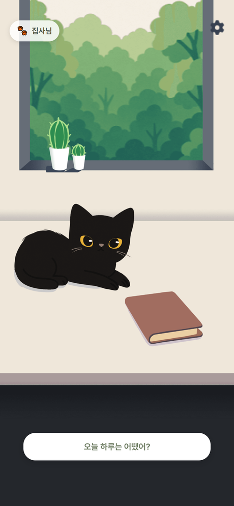
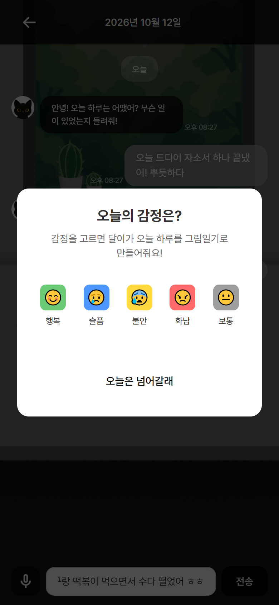
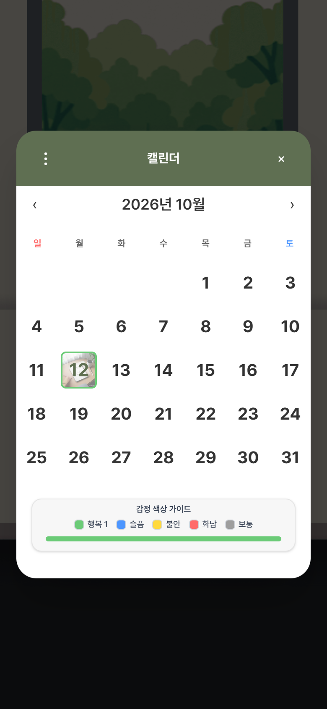
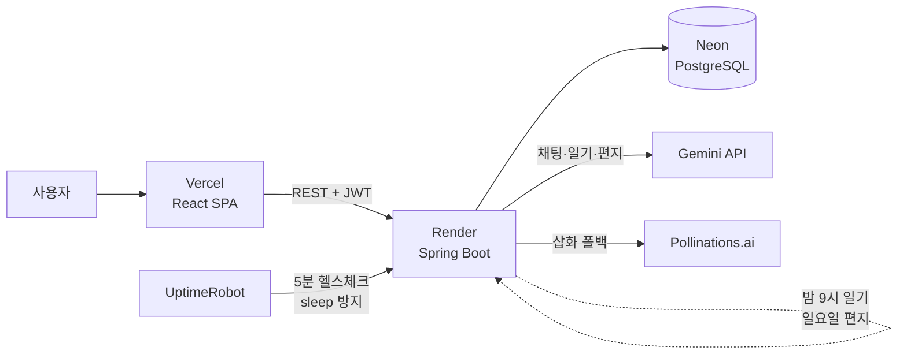

# Catus: 고립 전 청년을 위한 대화형 감정 기록 서비스

고양이 "달이"와의 짧은 대화가 그림일기가 되고, 주간 편지와 익명 응원으로 이어지는 서비스입니다.
이 저장소는 기획, 설계, 운영 기록을 담은 쇼케이스이며, 코드는 정식 출시 준비로 비공개입니다.

**Live Demo: https://catus-app.vercel.app** · **문서 사이트: https://freaks0.github.io/catus/**  
(게스트로 바로 체험 가능 · 모바일 화면 권장 · 무료 티어 서버라 첫 접속과 응답이 다소 느릴 수 있습니다)

| | |
|---|---|
| 역할 | 기획, 개발, 배포, 운영 1인 수행 |
| 상태 | 무료 티어 인프라(Render · Neon · Vercel)에서 일부 사용자 테스트 중, 정식 출시 준비 |
| 핵심 수치 | 프롬프트를 14,043자에서 3,666자로 압축해 응답 6.8s에서 1.5s. 일기와 삽화 프롬프트를 Gemini 1회 호출로 동시 생성 |
| 스택 | Java 21 · Spring Boot 3.2 · PostgreSQL · React 19 · Vite · Tailwind v4 · Gemini |
| 코드 | 비공개 (열람이 필요하면 메일로 요청: freaks17489@gmail.com) |
| 프로젝트 문서 | [기획](docs/01-planning.md) · [사용자 리서치](docs/06-user-research.md) · [ERD](docs/02-erd.md) · [시스템 설계](docs/03-architecture.md) · [디자인](docs/07-design.md) · [트러블슈팅](docs/04-troubleshooting.md) · [회고](docs/05-retrospective.md) |

> **Catus = Cat + Cactus.** 뾰족하다는 이유로 버림받은 선인장, 그리고 검은 고양이. 어딘가 모나다고 여겨지는 존재들이 서로의 곁이 되어주는 이야기에서 시작한 이름입니다.

## 왜 만들었나

마음돌봄 서비스는 힘들어진 사람이 "찾아와야" 시작됩니다.  
하지만 통계와 현장 인터뷰, 그리고 직접 수행한 연구(청년 고립 조기 탐지 모델, 2026 한국통신학회 동계학술대회 발표)가 가리키는 사실은 하나였습니다.  
**이미 고립된 청년은 서비스를 찾지 않는다.**  
그래서 찾아오게 만드는 대신, 고립되기 전의 일상에 미리 들어가 있도록 문제를 다시 정의했습니다. (재정의 과정 전체: [기획 문서](docs/01-planning.md))

그 접점을 상담이 아닌, 가장 가벼운 형태로 만들었습니다:

- 고양이 **"달이"** 와 가볍게 수다 떠는 것만으로 하루의 기록이 시작되고
- 그 **대화와 그날의 기분**을 재료로 그림일기가 대신 쓰여지고
- 대화가 쌓이면 달이가 나의 **성향 변화를 읽고**, 매주 한 주를 돌아보는 **편지**를 보내오고
- 공개를 선택하면 달이가 물어온 누군가의 하루에 응원을 보내고, 내 일기에는 **종이비행기**를 타고 익명의 응원이 날아듭니다

## 핵심 기능

| 기능 | 설명 |
|------|------|
| 달이와 대화 | 공감·되묻기·자기개방을 섞는 **대화 리듬 설계** + 시간대/감정/친밀도별 동적 컨텍스트 (Gemini 멀티턴) |
| 그림일기 자동 생성 | 대화 종료 시 감정 선택 후 **지정한 밤 시간에 배치 생성** (즉시 받기·추가 대화 반영 재생성 지원). 대화에 실제로 있었던 일만 쓰는 사실 충실성 규칙 |
| 삽화 | "달이가 크레용으로 그려준" 스타일 강제. Gemini 이미지 실패 시 **Pollinations 폴백** (무료 환경 대응) |
| 달이의 주간 편지 | 매주 일요일 저녁, 한 주의 일기들을 돌아보며 달이가 손편지 작성 (Big5 성향 변화 코멘트 포함) |
| Big5 성격 분석 | 초기 10문항 + **주간 대화 텍스트 기반 EMA 업데이트** (은어 정규화, 무의미 문장 필터, 강조어 가중, Sigmoid, EMA 순). 분석 결과가 달이의 대화 스타일에 역반영 |
| 익명 응원 | 공개 동의한 타인의 일기 무작위 열람 + 익명 응원 메시지 (발신자 AES-256-GCM 암호화) |

## 화면

| 홈 | 달이와 대화 | 감정 선택 |
|:---:|:---:|:---:|
|  |  |  |
| 방에서 쉬는 달이 (쓰다듬기, 선인장·책 인터랙션) | 공감하고 되묻는 대화 | 대화 종료 시 하루 감정 기록 |

| 그림일기 | 달이의 주간 편지 | 캘린더 |
|:---:|:---:|:---:|
|  |  |  |
| 대화 속 사실만 담은 일기 + 삽화 | 한 주를 돌아보는 손편지 | 감정 색상과 삽화로 모아보는 한 달 |

## 아키텍처

## 기술적 하이라이트

**1. 프롬프트 모듈 아키텍처 + 성능 튜닝**
- `base(인격·안전) + extension(채팅/일기/이미지/편지) + dynamic context(시간대·감정·친밀도·Big5 힌트)` 조합식 설계
- 비대해진 프롬프트를 규칙 보존 압축(14,043자에서 3,666자)해 **응답 속도 6.8s에서 1.5s**
- 위기 대응 4단계 프로토콜, 프롬프트 인젝션 방어(대화 내역 구분자 격리, 역할 변경 무시)

**2. LLM 호출 최적화**
- 일기 본문 + 이미지 프롬프트를 **Gemini 1회 호출**로 동시 생성 (`<diary>/<image>` 태그 파싱 + 미준수 폴백)
- 동일 프롬프트 이미지 캐싱, 삽화 실패가 일기 저장을 막지 않는 격리 설계

**3. 무료 인프라 제약을 설계로 해결**
- 휘발성 디스크: 삽화를 Pollinations **결정적 URL로 보존** (재시작에도 유지)
- Redis 부재: 블랙리스트 fail-open, 인증코드 인메모리 폴백, 캐시 프로필 분리 (`prod,render` 프로필 오버레이)
- Neon auto-suspend(5분): HikariCP `max-lifetime`을 그보다 짧게 설정해 끊긴 커넥션 재사용 방지
- 콜드스타트: 외부 헬스체크로 상시 가동 (15분 sleep 정책 우회)

**4. 보안**
- JWT Access/Refresh **타입 분리** (필터가 ACCESS만 인증 허용), 미인증 401 통일로 프론트 자동 재발급 연동
- 시스템 배치 API는 JWT + **HMAC-SHA256 이중 인증** (타이밍 공격 방지 비교)
- 소유권 위반 403 / 인증 실패 401 구분, 익명 메시지 발신자 AES-256-GCM 암호화, Bucket4j rate limit

**5. Big5 분석 파이프라인**
- 주간 ChatLog를 SlangNormalizer(은어 정규화), ZeroScoreFilter(유의미 문장 선별), IntensifierMultiplier(어절 경계 강조어 가중), Sigmoid(중립 5.5), **EMA 업데이트** 순으로 처리하고 이력을 추적
- 결과를 달이의 페르소나 힌트로 역주입 ("성향으로 사용자를 규정하지 않기" 가드 포함)

## 코드 저장소 안내

정식 출시를 준비하면서 백엔드·프론트엔드 코드 저장소는 비공개로 전환했습니다.  
이 저장소는 기획·설계·운영 과정을 담은 쇼케이스이며, 코드 열람이 필요한 분(채용 검토 등)은 freaks17489@gmail.com 으로 연락 주시면 열람 권한을 드립니다.

## API 개요

| 그룹 | 주요 엔드포인트 |
|------|----------------|
| 인증 `/api/auth` | 카카오 로그인, 게스트 체험 로그인, 토큰 갱신, 로그아웃, 탈퇴 (+dev 프로필 한정 dev-login) |
| 채팅 `/api/chat` | 메시지 전송(AI 응답), 이력, 날짜별 조회 |
| 일기 `/api/diary` | 목록·상세·수정·삭제, 감정 선택 저장, 즉시 생성/재생성, 삽화 재생성, 무작위 열람 |
| 편지 `/api/letters` | 주간 편지 목록·상세(읽음 처리)·즉시 생성 |
| 응원 `/api/message` | 익명 전송, 수신함, 알림, 읽음 |
| Big5 `/api/big5` | 초기 테스트, 현재 점수, 변화 이력 (+시스템 배치: 문장 분석, EMA 갱신) |
| 설정 `/api/settings` | 일기 시간, 공개 동의, 알림, 다크모드 |

## 스케줄러 (ShedLock 분산 락)

| 작업 | 주기 |
|---|---|
| 그림일기 생성 (사용자 지정 시간, 선택한 감정 반영) | 매시 정각 |
| 달이의 주간 편지 | 일요일 20:00 |
| Big5 EMA 업데이트 | 일요일 00:00 |

## 배포

Vercel(정적 프론트) + Render(백엔드 컨테이너) + Neon(PostgreSQL) 무료 티어 조합으로 배포해 테스트 운영 중이며, 사용자 증가 시 유료 인프라 전환을 전제로 설계했습니다 (삽화 고품질 경로 자동 복귀, 프로필 오버레이 기반 환경 분리 등).

## 로드맵

- 푸시 알림 (FCM), 일기별 Big5 미니 분석, 고품질 삽화 (Gemini 이미지 유료 전환 시 자동 적용, 프롬프트 체계 구축 완료)
