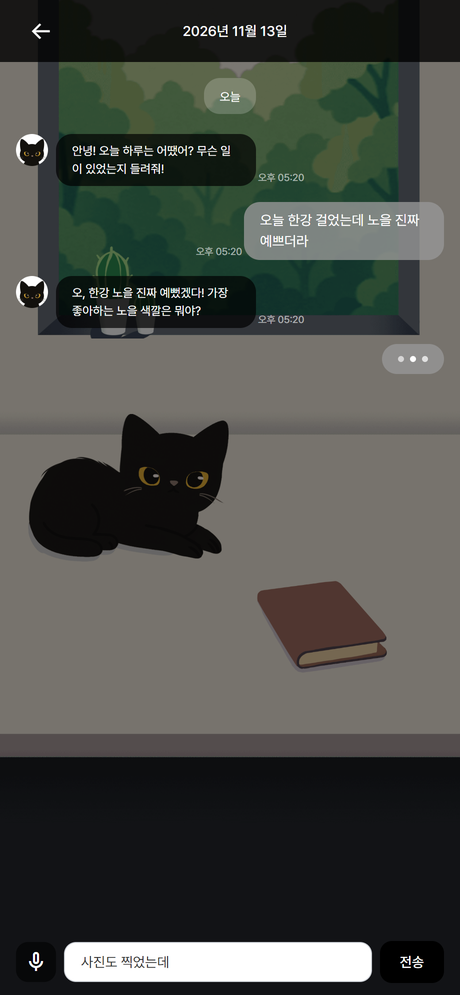
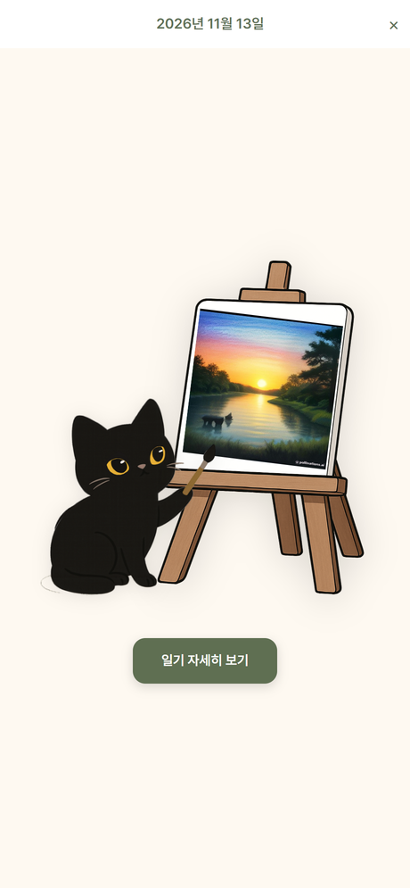
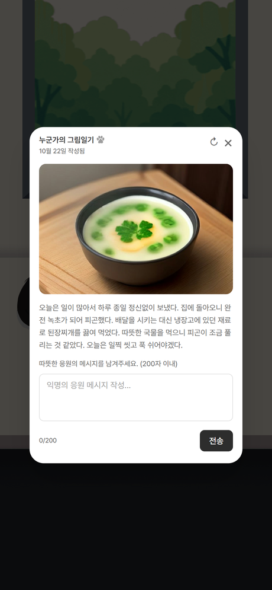

# Catus

하루 끝에 고양이 달이에게 오늘 있었던 일을 이야기하면, 그날 밤 그림일기가 도착하는 감정 기록 서비스입니다. 일요일에는 한 주를 돌아보는 편지가 오고, 공개한 일기에는 익명의 사용자가 응원을 남깁니다. 힘든 이야기를 꺼낼 곳이 없는 20대를 위해, 고립되기 전부터 매일 가볍게 쓰는 기록으로 일상에 자리 잡는 것을 목표로 만들었습니다.

**데모: https://catus-app.vercel.app** · **문서: https://freaks0.github.io/catus/**
가입 없이 게스트로 체험할 수 있고 모바일 화면에 맞춰 만들었습니다. 무료 서버라 첫 접속이 느릴 수 있습니다.

| 오늘 있었던 일을 달이에게 말하면 | 그날 밤 달이가 그림일기를 그려 옵니다 | 누군가의 일기가 날아오면 익명으로 응원을 보냅니다 |
|:---:|:---:|:---:|
|  |  |  |

## 이 저장소

기획, 디자인, 설계, 운영 과정을 정리한 문서 사이트의 원본입니다. 코드 저장소는 정식 출시 전이라 비공개이고, 열람이 필요하면 freaks17489@gmail.com 으로 연락 주세요.

| 페이지 | 내용 |
|---|---|
| [소개](https://freaks0.github.io/catus/) | 서비스 소개와 만든 사람 |
| [기획과 리서치](https://freaks0.github.io/catus/01-planning.html) | 20대 인터뷰에서 시작해 상담사와 창업가를 만나며 고립 전 청년으로 대상을 다시 정한 과정 |
| [디자인](https://freaks0.github.io/catus/07-design.html) | 첫 컨셉을 뒤집고, 손으로 그린 캐릭터가 앱 화면이 되기까지 |
| [설계](https://freaks0.github.io/catus/03-architecture.html) | 백엔드 구조와 LLM 프롬프트, 하루의 흐름과 데이터 모델 |
| [운영과 회고](https://freaks0.github.io/catus/04-troubleshooting.html) | 배포 뒤 겪은 문제와 회고 |

기획, 사용자 인터뷰, 백엔드와 LLM 프롬프트, 배포와 운영을 혼자 했고, 캐릭터는 직접 그린 뒤 디자이너와 함께 다듬었습니다. Java 21, Spring Boot 3.2, PostgreSQL, Gemini API, React 19, TypeScript로 만들었고 Vercel, Render, Neon 무료 티어에서 돌고 있습니다.

고립 전 개입이라는 방향은 1저자로 발표한 연구로 확인했습니다. 통신 메타데이터의 엔트로피 분석과 하이브리드 딥러닝 기반 청년 고립 탐지 (2026 한국통신학회 동계종합학술발표회).

## 로컬에서 보기

```
pip install -r requirements.txt
mkdocs serve
```

main에 푸시하면 GitHub Actions가 gh-pages로 배포합니다.
