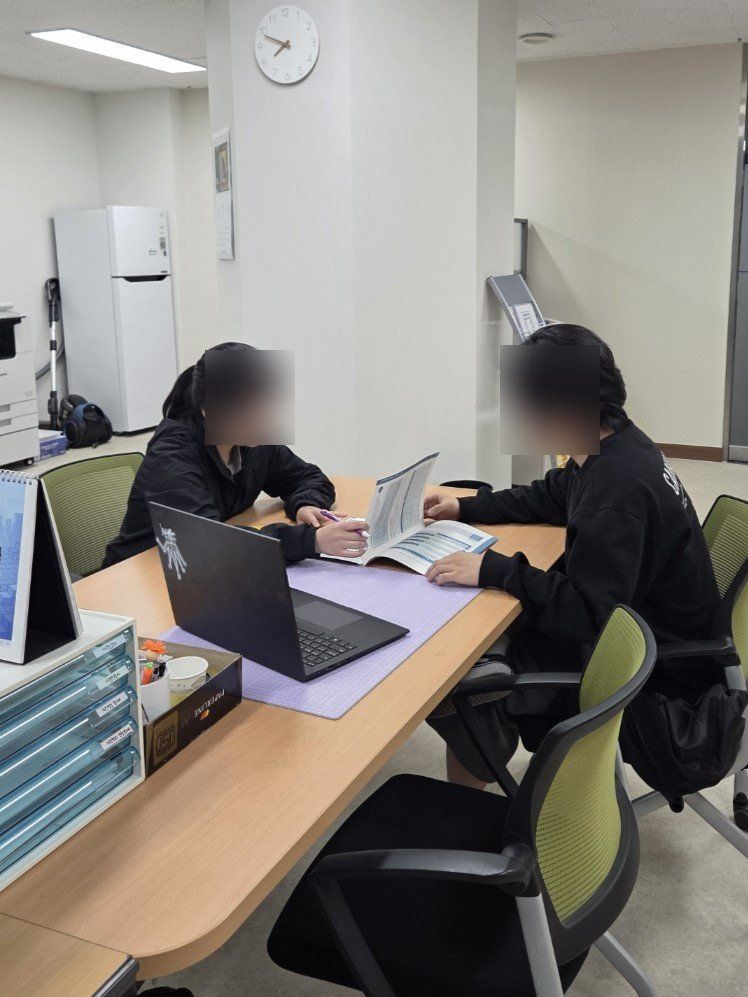

# 기획과 리서치

## 뉴스가 아니라 주변에서 보였다

고립 청년 문제가 뉴스에 오르내리던 때, 그 모습이 화면 밖 제 주변에서도 보인다고 느꼈습니다. 느낌만으로 무언가를 만들 수는 없어서 대학에서 20대들을 만나 이야기를 들었습니다. 듣다 보니 가설이 하나 생겼습니다. 고립은 특별한 누군가의 일이 아니라 누구에게나 올 수 있고, 그렇다면 고립된 뒤가 아니라 고립되기 전에 잡아야 한다는 것입니다.

## 왜 상담센터부터 찾아갔나

가설이 맞는지 혼자 판단할 수는 없었습니다. 먼저 조사 결과를 봤습니다. 지원 제도는 당사자가 찾아와야 시작되는데, 이미 고립된 사람은 찾아오지 않습니다. 고립 청년 지원 사업마다 "발굴"을 가장 어려운 문제로 꼽고 있었습니다.

통계가 현장에서도 그런지 묻고 싶어 대학 상담센터를 포함해 상담사 두 분을 만났고, 이 방향에 시장이 있는지 보려고 고립 청년 분야 창업가들도 찾아다녔습니다. 상담사의 답은 통계보다 단순했습니다.

> "(내담자는) 필요할 때 온다."

> "진단받은 사람을 대상으로 할 거면 의사, 상담을 대상으로 할 거면 상담사. 아무것도 아닌 사람들이 대상이라면, 지원해줄 수 있는 곳이 어디 있는지부터가 문제다."

상담은 본인이 필요를 느껴야 시작됩니다. 아직 환자도 내담자도 아닌 사람에게는 마음을 돌볼 통로 자체가 없었습니다. Catus는 그 빈자리를 맡기로 했습니다. 서비스가 진단이나 치료를 자처하지 않는다는 선도 여기서 정해졌습니다.

창업가들의 답은 더 현실적이었습니다. 한 분은 고립 청년 아이템을 다음 사업으로 준비하고 있었는데, 고립 청년은 소비를 하지 않아 수익 구조가 안 나오니 다른 방향을 찾아보라고 했습니다. 초등학교 교사 부부는 아이들 일기 프로그램을 만들어 운영하고 있었습니다. 교사라서 마케팅 비용 없이 그대로 유통할 수 있었고, 그 조건이 아니었으면 힘들었을 거라고 했습니다. 고립된 뒤의 청년은 찾아오지도 않고 시장으로도 성립하지 않습니다. 일기 서비스가 살아남으려면 사람이 모이는 길부터 있어야 했습니다.

### 고립은 어느 날 갑자기 오지 않는다

고립 전에 개입한다는 방향이 데이터로도 맞는지 보고 싶었습니다. 통신 메타데이터로 청년 고립을 탐지하는 연구를 해서 1저자로 학회에서 발표했습니다.

> 통신 메타데이터의 엔트로피 분석과 하이브리드 딥러닝 기반 청년 고립 탐지 (2026 한국통신학회 동계종합학술발표회)

예비 연구라 결과를 과신하지는 않습니다. 그래도 두 가지는 분명했습니다. 고립 위험군은 통신 상대가 눈에 띄게 단조롭고, 고립은 어느 날 갑자기가 아니라 시간을 두고 깊어집니다. 그렇다면 개입은 소통이 단조로워지기 시작하는 초기에 해야 합니다. 그때의 사람은 아직 일상을 살고 있으니, 서비스도 그 일상 안에 있어야 합니다.

## 고립 청년이 아니라 고립 전 청년

처음 생각한 것은 고립 청년을 돕는 서비스였습니다. 상담센터와 연구를 거치고 나니 그 대상에게는 서비스가 닿지 않는다는 것이 분명해졌습니다. 그래서 대상을 바꿨습니다.

> 고립 청년을 위한 서비스 → 고립되기 전의 청년이 고립되지 않도록, 일상에 미리 들어가 있는 서비스

찾아와서 가입하는 지원 서비스로는 안 됩니다. 힘들어지기 전부터 쓰고 있을 만큼 가볍고 일상적이어야 합니다. 상담이나 치료처럼 보이는 것을 다 빼고 나니 하루 끝에 고양이와 수다 떠는 일기장이 남았습니다. 사람들은 일기 쓰기는 어려워해도 오늘 있었던 일을 누군가에게 말하기는 어려워하지 않습니다. 대화만 하면 일기가 쓰인다면, 기록은 그대로 남기고 쓰는 수고만 없앨 수 있습니다.

## 털어놓고 싶지만 보이기는 싫다

이 컨셉을 들고 20대 초중반을 다시 만났습니다. 직장인, 사업자, 대학원생이었고, 평소 힘든 이야기를 누구에게 하는지와 이런 서비스를 쓸 것 같은지를 물었습니다.

말을 꺼낼 상대가 없다기보다, 상대가 있어도 꺼내지 않는다는 답이 많았습니다.

> "상대방이 힘들까봐 먼저 내 이야기를 꺼내지 않는 편입니다. 그래서 내면에 감정이 쌓이는 경우가 많습니다." (26세 남성)

> "그럴 땐 '그럴 수도 있어요' 같은 말 한마디면 충분히 위로가 됩니다. 해결책보단 공감이 먼저입니다." (26세 남성)

친구가 없는 것이 아니었습니다. 약한 모습을 보여도 되는 자리가 없었습니다.

### AI 위로는 정신승리라는 말

컨셉에 대한 반응이 모두 호의적이지는 않았습니다.

> "매일 좋은 말만 해주는 챗봇과 소통하면 스트레스는 덜 받겠지만, 정신승리일 뿐이다. AI로 외로움이 해소되면 현실의 관계에 소홀해지며 더 고립될 가능성을 우려한다." (22세 여성)

> "사람의 외로움과 소통의 갈증은 AI로써 해결될 수 없다고 생각한다. (...) AI와 소통하는 게 아닌, AI를 통해 사람들과 소통하는 방식이라면 저는 매우 좋을 것 같다." (25세 남성)

이 두 답이 서비스의 원칙 하나를 정했습니다. AI는 기록을 돕고, 위로는 사람이 보냅니다.

### 공통으로 요구한 것

- 개인정보 보호. 과반이 가장 중요한 것으로 먼저 꼽았습니다. "민감하거나 사적인 이야기가 퍼졌을 때 문제가 될 수 있다."
- 기억과 맥락. "이전 대화를 기억해 주는 것이 중요하다", "나의 오늘 하루를 함께 살아주는 느낌의 대화"
- 지속 가능한 설계. "꾸준히 할 수 있도록 설계돼야 의미가 있다", "기록 의지가 없는 사람에겐 귀찮을 수 있다"

## 들은 말과 정한 것

| 들은 것 | 결정한 것 |
|---|---|
| "약한 모습을 보이기 싫다" / "상대가 힘들까봐 말을 못 꺼낸다" | 친구 추가와 커뮤니티 기능 제외. 익명, 단방향, 본인이 공개한 일기에만 오는 응원 구조 |
| "AI를 통해 사람들과 소통하는 방식이라면 좋겠다" | 떠도는 일기. 위로는 AI가 아니라 익명의 사람이 보내는 구조 |
| "AI 위로는 정신승리, 더 고립될 수도 있다" | 고립 전 개입으로 문제 재정의. AI는 기록 도우미로 한정, 위로의 주체에서 제외 |
| "이전 대화를 기억해야 교감이다" | 멀티턴 컨텍스트, 친밀도 단계, 한 주를 기억해 쓰는 주간 편지 |
| "일기는 사실로 기록해야지" | 일기 사실 충실성 규칙. 대화에 없던 사건과 감정은 쓰지 않음 |
| "꾸준히 하게 설계돼야 의미 있다" | 쓰기 부담 제거(대화가 곧 기록), 도착 알림 |
| "너무 현실적이거나 차가운 그림보다 감정의 온도를 담은 표현이 와닿는다" | 사실적인 일러스트 대신 납작하고 따뜻한 파스텔 톤 |
| "내 이야기가 퍼지면 문제다" | 공개 기본 OFF, 발신자 암호화, 학습에 미사용 |

## 들었지만 따르지 않은 말

AI 소개팅 제안이 있었습니다. 외로움의 원인을 연애 부재로 본 제안인데, 이 서비스가 정의한 문제는 감정을 꺼낼 통로가 없다는 것이고, "약한 모습을 보이기 싫다"는 발견과도 부딪힙니다.

SNS와 갤러리 연동은 편리하지만 일기가 밖으로 나가는 길을 만듭니다. "퍼질까 봐 두렵다"는 공통 요구와 부딪혀 넣지 않았습니다.

## 이름과 캐릭터

이름은 Catus, Cat과 Cactus를 합쳤습니다. 12간지에서 탈락해 밤을 택한 검은 고양이 달이와 뾰족하다는 이유로 버려진 선인장 선이 서로의 이야기를 묵묵히 들어주며 함께 자라는 세계관을 기획 초기에 먼저 썼습니다. 서비스의 역할도 같습니다. 기록을 요구하지 않고 곁에서 들어 줍니다. 캐릭터를 그린 과정은 [디자인](07-design.md)에 적었습니다.

## 이번에 하지 않기로 한 것

- 네이티브 앱. 앱 심사와 배포 비용 없이 링크 하나로 데모할 수 있어야 해서 웹 퍼스트로 갔습니다.
- 돈이 드는 인프라. 개인 프로젝트가 계속 살아 있으려면 운영비가 0원이어야 했고, 이 제약이 아키텍처 결정 다수를 끌고 갔습니다 ([설계](03-architecture.md) 참조).
- 푸시 알림. 네이티브 앱과 함께 이번 범위에서 뺐습니다.
- 고립 신호 조기 감지. 연구에서 제안한 내용을 서비스에 연결하는 것은 장기 계획으로 남겨 뒀습니다.
