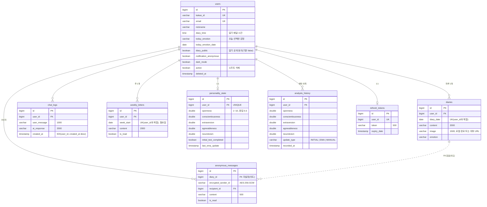

# 02. 데이터 모델 (ERD)

> **요약** — 9개 테이블. 핵심 결정 넷: 하루 1일기 유니크 제약을 동시성의 최종 방어선으로, 조회 전용 테이블은 연관관계 대신 ID 컬럼으로, 익명 응원은 일기가 삭제돼도 살아남도록 FK를 의도적으로 생략, 발신자 식별자는 암호화 저장.

스키마 원본: [init-db.sql](../init-db.sql) — prod는 `ddl-auto: validate`라 이 스크립트가 유일한 스키마 생성 경로이며, 엔티티와 1:1 동기화를 유지한다.

(이외에 스케줄러 분산 락용 `shedlock` 테이블이 있다 — 도메인 데이터가 아니라 다이어그램에서 제외)

## 설계 결정과 이유

### `(user_id, diary_date)` 유니크 인덱스 — 동시성의 최종 방어선

"하루에 일기 1개"는 애플리케이션에서 중복 체크를 하지만, 체크와 저장 사이의 경합(동시 요청, 스케줄러와 수동 생성 충돌)은 코드만으로 못 막는다. 유니크 제약을 **최종 방어선**으로 두고, 서비스 코드는 `DataIntegrityViolationException`을 받아 중복 응답으로 번역한다. 단, 무결성 위반이 전부 중복은 아니므로(컬럼 길이 초과 등) 재조회로 실제 중복 여부를 확인한 뒤 번역한다.

### 연관관계 대신 `user_id` Long 컬럼 (Diary, ChatLog, WeeklyLetter)

JPA `@ManyToOne` 대신 ID 값만 보관했다.

- 이 테이블들은 항상 "내 것만" user_id로 조회하며, User 객체 그래프 탐색이 필요한 유스케이스가 없다
- 연관관계가 없으면 N+1, LazyInitialization, 양방향 순환 같은 문제 자체가 생기지 않는다
- DB 레벨 FK 제약은 유지해 정합성은 지킨다 (참조 무결성과 객체 참조는 별개 문제)

반면 `PersonalityState`·`AnalysisHistory`는 분석 파이프라인에서 User 정보와 함께 다뤄져 `@ManyToOne(LAZY)`를 사용 — 일괄 원칙보다 유스케이스 기준으로 선택했다.

### `anonymous_messages.diary_id`에 FK를 걸지 않은 이유

일기를 삭제해도 **받은 응원 메시지는 보존**되는 것이 기획 의도다(응원은 수신자의 자산). FK + CASCADE면 함께 삭제되고, FK + RESTRICT면 일기 삭제가 막힌다. 의도적으로 FK를 생략하고 인덱스만 유지했으며, 이 결정은 스키마 주석으로 문서화했다.

### 발신자 암호화 (`encrypted_sender_id`)

익명 응원의 "익명"을 DB 유출 상황에서도 지키기 위해 발신자 식별자를 AES-256-GCM으로 암호화 저장한다. 평문 컬럼이었다면 DB를 읽을 수 있는 누구나 익명성을 깰 수 있다. 신고 처리 등 운영상 필요할 때만 서버 키로 복호화 가능하다.

### `weekly_letters (user_id, week_start)` 유니크 — 자연키 기반 upsert

주간 편지는 "주당 1통"이 자연키다. 유니크 제약 덕에 "이번 주 편지 미리 받기"를 여러 번 눌러도 upsert(있으면 내용 갱신 + 미읽음 복귀)로 수렴하고, 스케줄러와 수동 생성이 충돌해도 중복이 생기지 않는다.

### `personality_state`(현재) / `analysis_history`(이력) 분리

현재 점수는 1:1 단일 로우로 빠르게 읽고, 변화 추적은 append-only 이력 테이블로 분리했다. 주간 편지의 "성향 변화 코멘트"는 이력의 최근 2건 비교로 구현 — 현재 테이블만 있었다면 불가능했을 기능이다.

### 소프트 삭제 (`users.active`, `deleted_at`)

탈퇴 시 하드 삭제 대신 비활성화. 공개 일기 조회 등 모든 노출 쿼리가 `active = true`를 조건으로 건다.

## 인덱스 전략

| 인덱스 | 근거 쿼리 |
|---|---|
| `diaries (user_id, diary_date)` UNIQUE | 오늘 일기 존재 확인, 월별 범위 조회, 중복 방어 |
| `chat_logs (user_id, created_at DESC)` | "오늘 대화" 범위 조회, 최근 N건 컨텍스트 로드 |
| `users (diary_time, active)` | 매시 정각 스케줄러의 대상 사용자 조회 (풀스캔 방지) |
| `anonymous_messages (recipient_id, is_read)` | 수신함 + 미읽음 뱃지 카운트 |
| `analysis_history (user_id, recorded_at)` | 기간별 성향 변화 그래프 |

날짜 조회는 `FUNCTION('MONTH', ...)` 방식 대신 **범위 조건**(`>= start AND < end`)으로 작성해 인덱스를 타게 했다.
