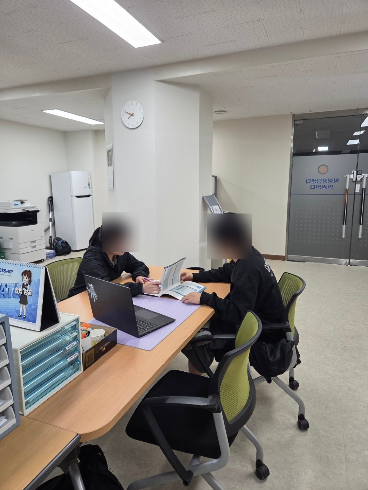

# 06. 사용자 리서치 — 인터뷰가 바꾼 설계

기획 단계에서 수행한 사전 조사와, 그 결과가 실제 설계 결정으로 이어진 과정의 기록이다.
모든 인용은 익명 처리했으며, 원문(인터뷰 전문·현장 기록)은 개인정보 보호를 위해 공개 저장소에 포함하지 않는다.

## 조사 개요

| 방법 | 대상 | 내용 |
|---|---|---|
| 심층 인터뷰 | 20대 초중반 남녀 7명 (1인·다인 가구, 직장인·사업자·대학원생, 다양한 성향) | 반구조화 설문 4개 섹션 — 일상·소통 습관 / 정서 교감·자기성찰 니즈 / 서비스 컨셉 반응 / 이용 의향·가격 수용선 |
| 현장 인터뷰 | 고립청년 분야 창업가, 상담 전문가 | 고립청년 시장의 실제 — "이미 고립된 사람은 서비스를 찾지 않는다" |
| 데이터 연구 | 서울시 시민생활 데이터 12,450명 | 통신 패턴 기반 고립 조기 탐지 (→ [01. 기획](01-planning.md)) |

## 발견 1. 니즈는 실재한다 — "꺼낼 곳이 없다"

> "상대방이 힘들까봐 먼저 내 이야기를 꺼내지 않는 편입니다. 그래서 내면에 감정이 쌓이는 경우가 많습니다." — 26세 남성

> "감정이 벅차오르는데 꺼낼 곳이 없을 때 외로움을 느낍니다." — 26세 남성

> "타인에게 말하기 어려운 일이나 개인적인 문제들도 부담 없이 이야기할 수 있어서 좋을 것 같다." — 25세 남성

> "그럴 땐 '그럴 수도 있어요' 같은 말 한마디면 충분히 위로가 됩니다. 해결책보단 공감이 먼저입니다." — 26세 남성

가까운 친구가 있는 사람들조차 "힘든 이야기"는 꺼내지 못하고 있었다. 문제는 관계의 부재가 아니라 **약한 모습을 보일 수 있는 통로의 부재**였다.

## 발견 2. 회의적인 목소리 — 그대로 기록한다

긍정 반응만 있었던 것이 아니다. 가장 아픈 지적들:

> "매일 좋은 말만 해주는 챗봇과 소통하면 스트레스는 덜 받겠지만, 정신승리일 뿐이다. AI로 외로움이 해소되면 현실의 관계에 소홀해지며 **더 고립될 가능성**을 우려한다." — 22세 여성

> "사람의 외로움과 소통의 갈증은 AI로써 해결될 수 없다고 생각한다. (...) **AI와 소통하는 게 아닌, AI를 통해 사람들과 소통하는 방식이라면 저는 매우 좋을 것 같다.**" — 25세 남성

> "AI가 학습되어 나의 기억이 다른 곳에 악용될까 망설여진다." — 25세 여성

이 지적들은 서비스의 방향을 실제로 바꿨다 (아래 반영 표 참조). 특히 "AI를 통해 사람들과 소통"이라는 문장은 익명 응원 기능의 설계 문장이 됐다 — **AI는 기록을 돕는 존재일 뿐, 위로는 결국 사람(익명의 타인)에게서 온다.**

## 발견 3. 공통 요구

- **개인정보 보호** — 7명 중 과반이 "가장 중요한 것"으로 자발적으로 꼽음. "민감하거나 사적인 이야기가 퍼졌을 때 문제가 될 수 있다."
- **기억과 맥락** — "이전 대화를 기억해 주는 것이 중요하다", "나의 오늘 하루를 함께 살아주는 느낌의 대화"
- **지속 가능한 설계** — "꾸준히 할 수 있도록 설계돼야 의미가 있다", "기록 의지가 없는 사람에겐 귀찮을 수 있다"
- **가격 수용선** — 기본 무료 전제, 프리미엄 월 3,000~5,000원 선에 수렴

## 현장의 목소리 — 상담 전문가 인터뷰

멘탈케어 시장을 현장에서 겪는 상담 전문가를 직접 찾아가 물었다 (얼굴은 블러 처리).

기획의 경계를 그어준 답변들:

> **"(내담자는) 필요할 때 온다."**

상담은 본인이 필요를 느껴 찾아와야만 시작된다 — "이미 고립된 사람은 서비스를 찾지 않는다"는 재정의를 현장에서 재확인해준 문장.

> **"진단받은 사람을 대상으로 할 거면 의사, 상담을 대상으로 할 거면 상담사. 아무것도 아닌 사람들이 대상이라면, 지원해줄 수 있는 곳이 어디 있는지부터가 문제다."**

타깃을 셋으로 갈라준 조언. Catus의 자리는 세 번째 — 아직 '환자'도 '내담자'도 아니지만 마음을 돌볼 통로가 없는 사람들이다. 동시에 이 구분은 서비스가 진단·치료를 자처해서는 안 된다는 경계선이기도 하다 (멘탈케어 관련 법적 표현 주의, 비의료 고지 → 출시 체크리스트에 반영).

> **"대면 상담의 힘은 '같이 있는 느낌'이다."**

달이를 해결사가 아니라 '곁'으로 설계한 방향을 현장의 언어로 지지해준 말.

> **"상담 검사지는 밸리데이션된 것이고, 문구 하나·단어 하나에 저작권이 있다."**

기존 심리 검사지를 그대로 가져다 쓸 수 없다는 경고 — Big5 초기 테스트 문항을 자체 구성한 이유.

## 인터뷰 → 설계 반영

| 들은 것 | 결정된 것 |
|---|---|
| "약한 모습을 보이기 싫다" / "상대가 힘들까봐 말을 못 꺼낸다" | 친구추가·커뮤니티 **배제**, 익명·단방향·옵트인 응원 구조 |
| "AI를 통해 사람들과 소통하는 방식이라면 좋겠다" | 떠도는 일기 — AI가 아니라 **익명의 사람이 보내는 위로**를 전달하는 설계 |
| "AI 위로는 정신승리, 더 고립될 수도 있다" | "고립 전 개입"으로 문제 재정의 + AI는 기록 도우미로 포지셔닝 (위로의 주체가 아님) |
| "이전 대화를 기억해야 교감이다" | 멀티턴 컨텍스트, 친밀도 단계, 한 주를 기억해 쓰는 주간 편지 |
| "일기는 사실로 기록해야지" | 일기 사실 충실성 규칙 — 대화에 없던 사건·감정 생성 금지 |
| "꾸준히 하게 설계돼야 의미 있다" | 쓰기 부담 제거(대화=기록), 밤 배달 내러티브, 도착 알림 |
| "내 이야기가 퍼지면 문제다" | 공개 기본 OFF, 발신자 암호화, 학습 미사용 |
| 가격 수용선 3~5천 원 | 기본 무료 유지, 프리미엄은 로드맵으로 |

## 따르지 않은 의견과 그 이유

다수 의견이어도 채택하지 않은 것들 — 그리고 왜.

**1) 그림 스타일: "사실적 묘사" 다수 → 크레용·파스텔 채택.**
7명 중 4명이 사실적 묘사를 원했다. 그럼에도 채택하지 않은 이유: ① 사실적 그림은 사용자의 실제 기억(사진)과 직접 비교당하는 순간 어색함이 부각된다(기대 수준이 사진이 됨) ② "달이가 그려준 일기"라는 세계관과 충돌한다 ③ 소수 의견이 방향을 정확히 짚었다 — *"너무 현실적이거나 차가운 그림보다는 **감정의 온도를 담은 표현**이 더 와닿습니다."* 감정 기록에서 중요한 건 정확한 재현이 아니라 그날의 온도다.

**2) "AI 소개팅으로 만들어라" → 범위 밖으로.**
외로움의 원인을 연애 부재로 본 제안. 흥미롭지만 서비스의 문제 정의(감정을 꺼낼 통로의 부재)와 다른 문제였고, 매칭 서비스는 "약한 모습을 보이기 싫다"는 핵심 발견과 정면 충돌한다.

**3) "SNS·갤러리 연동" → 보류.**
편의성 제안이지만, 일기가 외부 플랫폼으로 흘러가는 경로는 "퍼질까 봐 두렵다"는 공통 요구와 충돌. 프라이버시가 신뢰의 전제인 서비스라 보수적으로 판단했다.
