# 디자인

> **요약** 첫 컨셉 하루온(밤바다의 배와 다섯 꽃)을 버리고 창가의 방과 두 캐릭터(달이와 선)로 다시 설계했다. 달이는 네 번 다시 그렸다. 배경부터 캐릭터까지 전부 직접 그렸다.

외부 디자이너 없이 피그마로 직접 진행한 디자인 과정의 기록이다. 컨셉은 한 번 완전히 뒤집혔고, 캐릭터는 여러 번 다시 그렸다. 그 흔적이 세 개의 피그마 파일에 남아 있다.

## 첫 컨셉: 하루온

첫 번째 컨셉의 이름은 "하루온"이었다. 은유 체계는 이렇다. 나의 내면은 배, 성장시킬 무언가는 식물(꽃과 열매), 하루하루는 항해. 사용자는 밤바다 위 자신의 배에서 꽃을 키우며 내면을 돌본다.

| 하루온 표지 | 하루온 홈 화면 |
|:---:|:---:|
|  | 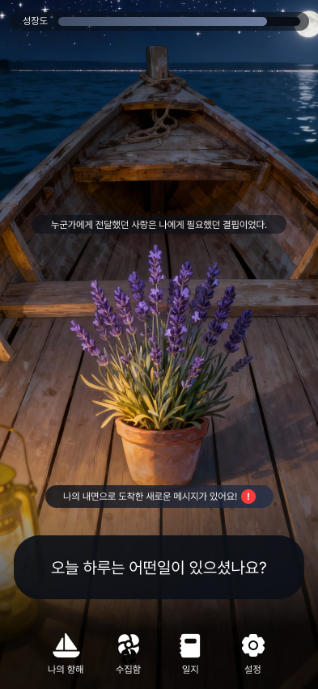 |
| "고요한 바다 위에 피어나는 나의 내면" | 메뉴: 나의 항해 · 수집함 · 일지 / 상단 성장도 게이지 |

하루온 단계에서 이미 성향 분석 결과를 식물로 표현한다는 아이디어가 있었다. 라벤더(평온), 연꽃(역경 극복), 해바라기(삶의 목적), 피스 릴리(회복탄력성), 수선화(새로운 시작) 다섯 꽃에 심리적 상징을 하나씩 정해 두었고, 이 매핑이 지금의 Big5 분석과 선인장으로 이어졌다.

|  |  |  |  |  |
|:---:|:---:|:---:|:---:|:---:|
| 라벤더 | 연꽃 | 해바라기 | 피스 릴리 | 수선화 |

## 컨셉 전환: 달이와 선

하루온 컨셉은 폐기됐다. 파일에 남은 실험 흔적(이미지 생성 모델 비교 리서치, "식물 일관성 프롬프트" 실험)이 보여주듯, 사실적 일러스트 톤은 AI 생성 이미지의 일관성을 유지하기 어려웠고, 다섯 가지 꽃의 상징 체계는 관리해야 할 세계관이 너무 많았다.

재편의 방향은 여러 식물의 상징을 버려진 존재 둘의 이야기로 모으는 것이었다.

달이(Moony)는 검은 고양이다. 12간지에서 탈락한 고양이로, 모두가 인정받던 동물들 사이에서 혼자 남겨졌고 그래서 밤을 택했다. 밤은 자신을 있는 그대로 받아주기 때문이다. 이름 "달이"는 그 밤의 달에서 왔다. 섬세하고 감정이 풍부하며, 사용자처럼 혼자라고 느껴본 적 있는 친구다. 달이가 밤에 일기를 가져다주는 서비스 구조는 이 설정에서 나왔다.

선(Seon)은 선인장이다. 뾰족하다는 이유로 누군가 버린 식물로, 햇빛도 물도 부족한 베란다에서 살아남으며 더 단단해졌다. 조용하지만 든든하고, 침묵으로 말한다. 세계관 원문에서 달이는 선의 가시를 만지며 "내 날카로움도 괜찮구나"를 배우고, 선은 가장 어두운 시간을 견딘 끝에 분홍 꽃을 피운다. 어느 밤 베란다 구석에서 혼자였던 둘이 만나 서로의 곁이 되어준다는 이야기다.

톤도 사실적 일러스트에서 납작하고 따뜻한 파스텔로 바뀌었다. 사용자 인터뷰의 소수 의견이 이 방향을 지지했다. "너무 현실적이거나 차가운 그림보다는 감정의 온도를 담은 표현이 더 와닿습니다."

### 달이의 변천

고양이 캐릭터는 네 번 다시 그렸다. 주황 고양이가 선인장을 안고 있던 첫 로고에서 시작해, 픽셀풍 간이 시안("MyCat")을 지나, 세계관(밤을 택한 검은 고양이)이 잡히며 검은 고양이로 다시 그렸고, 이후에도 눈매와 비율을 미세하게 조정하는 반복을 거쳤다.

| 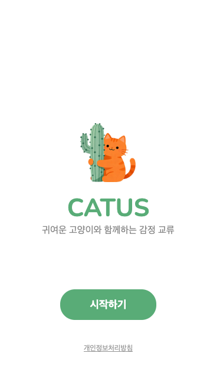 | 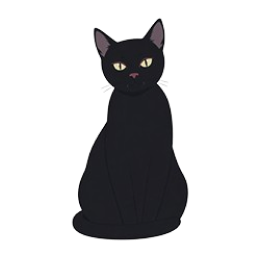 | 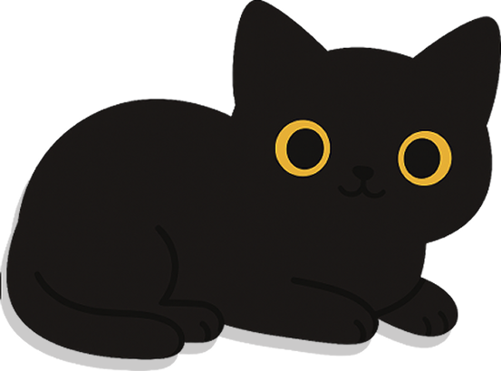 | 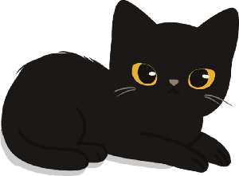 |
|:---:|:---:|:---:|:---:|
| 첫 로고 시안: 주황 고양이와 선인장 | 검은 고양이 전환: 날카로운 눈매 | 둥근 링 모양 눈 버전 | 최종 달이 (실제 앱 에셋): 아몬드형 눈에 빛 반사, 갈색 코, 수염 |

날카로운 눈에서 동그란 링으로, 다시 빛이 담긴 아몬드형 눈으로 바뀌었다. 마지막 단계에서 눈에 흰 하이라이트를 넣어 밤에도 반짝이는 눈으로 만들었다.

### 손으로 그린 달이와 선

캐릭터와 에셋은 외부 소스 없이 직접 그렸다. 앱에 들어간 컷 외에도 달이와 선의 일상을 그린 드로잉 시리즈가 쌓였는데, 세계관의 디테일(선이 피운 분홍 꽃)까지 그림 속에 녹아 있다.

| 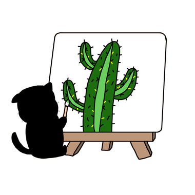 | 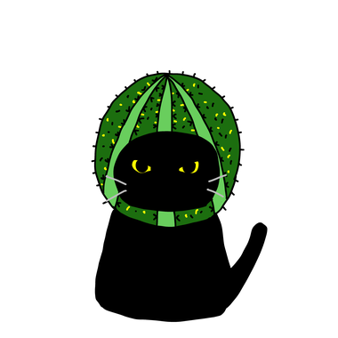 |
|:---:|:---:|
| 이젤 앞에서 선을 그리는 달이. "달이가 그려주는 그림일기" 그 자체 | 선인장 모자를 쓴 달이 |
| 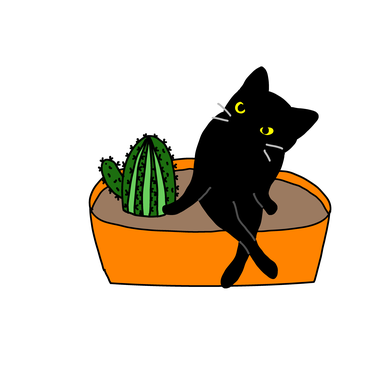 | 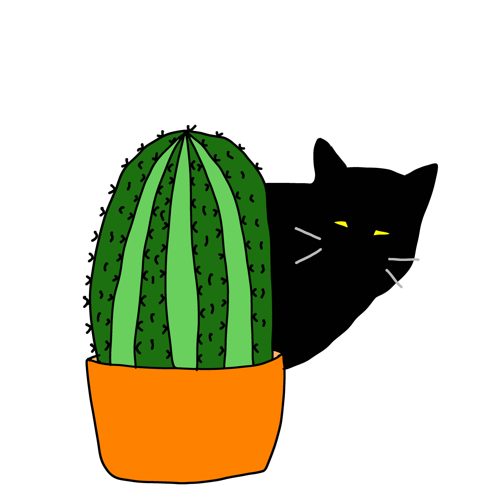 |
| 화분을 쏟고 시치미 떼는 달이 (쏟아진 선인장에 분홍 꽃) | 선 뒤에 숨은 달이 |

## 확정된 방 씬

최종 확정된 방 씬이다. 배경 숲, 창틀, 선인장 둘, 공책, 종이비행기, 달이까지 모든 오브젝트를 직접 그려서 한 장면으로 합성했고, 낮과 밤 두 벌로 만들었다. 밤 씬은 달이가 일기를 가져다주는 시간대의 화면이자 다크모드 배경이다. 구현은 이 씬을 거의 그대로 재현했다.

| 낮 씬 | 밤 씬 | 실제 구현 (웹) |
|:---:|:---:|:---:|
|  |  |  |

### 응원 메시지의 표현

응원 메시지의 표현 방식은 그리기 전에 문장으로 먼저 정했다. 피그마에 남아 있는 당시의 정의다.

> "다른 사용자의 그림일기가 날아온 걸 종이비행기로 표현"
> "다른 사용자가 나의 그림일기에 메시지를 보내줬을 때 일기장에 말풍선으로 표시"

구현에서는 이 설정이 두 갈래로 다듬어졌다. 타인의 떠도는 일기는 달이를 세 번 쓰다듬으면 달이가 물어다 주고(세계관 문서의 "달이가 물고 온다"가 채택됐다), 응원 메시지가 도착하면 종이비행기가 창가로 날아든다. 아래는 응원 메시지함 작업 화면이다. 왼쪽이 확정 시안(노트 위 발자국, 화면 아래에서 빼꼼 내다보는 달이와 선), 오른쪽은 그보다 이른 픽셀풍 탐색 시안(MyCat)이다.

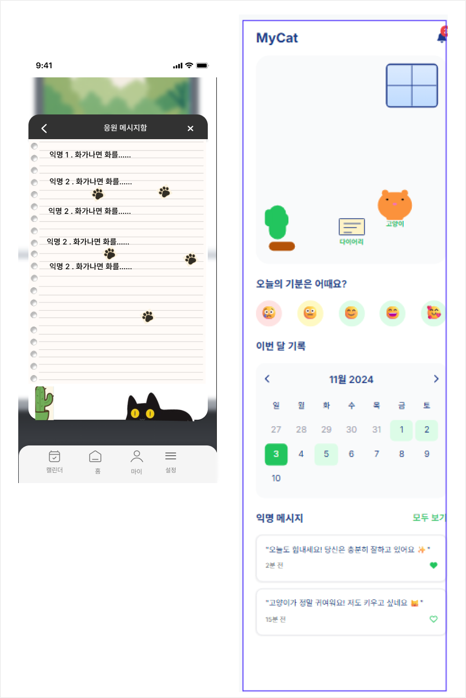

## 사용자 흐름도

와이어프레임 외에도 서비스 전체를 설계한 산출물이 함께 남아 있다. 회원가입 퍼널 정의, 온보딩 시나리오(감정분석 온보딩 1~8), 그리고 가입부터 배치 일기 생성, 공개 범위, 구독 모델(월 4,900~9,900원 가설. 인터뷰에서 확인한 수용선은 3,000~5,000원이었다)까지 그린 사용자 흐름도다.

<b>사용자 흐름도 전체 보기</b> (세로로 긴 다이어그램)

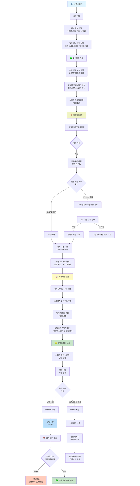

흐름도의 뼈대(가입, 성향 분석, 자유 대화, 지정 시간 배치 생성, 공개 선택, 익명 응원)는 실제 구현과 거의 일치한다. 구독과 채팅 횟수 제한 같은 수익화 요소는 구현에서 제외하고 로드맵으로 남겼다.

## 구현으로 이어진 것 / 달라진 것

<b>설계와 구현 매핑 표 펼쳐 보기</b>

| 피그마 설계 | 구현 |
|---|---|
| 창가의 방 + 선인장 + 달이 + 책 | 그대로 (에셋 직접 제작) |
| 음성 입력 버튼 | 그대로 (Web Speech API) |
| 종이비행기로 날아오는 타인의 일기 | 그대로 |
| 성향 분석 온보딩(가이드 대화 5~10분) | 10문항 테스트 + 주간 대화 기반 EMA로 간소화 |
| 채팅 횟수 제한·구독 유도 | 제외 (무료, 로드맵) |
| 일기 생성 "설정 시간 2~3시간 전 배치" | 사용자 지정 시간 정각 배치 + 미리 받기·재생성 |

