# 디자인

캐릭터는 손으로 직접 그린 뒤 디자이너와 함께 피그마에서 다듬었습니다. 컨셉은 한 번 완전히 뒤집혔고, 고양이는 네 번 다시 그렸습니다.

## 첫 컨셉, 하루온

첫 컨셉은 하루온이었습니다. 내면을 배에, 키워야 할 것을 꽃과 열매에, 하루를 항해에 빗댔습니다. 사용자는 밤바다 위 자기 배에서 꽃을 키우며 내면을 돌봅니다.

| 하루온 표지 | 하루온 홈 화면 |
|:---:|:---:|
| 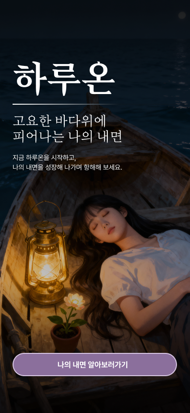 | 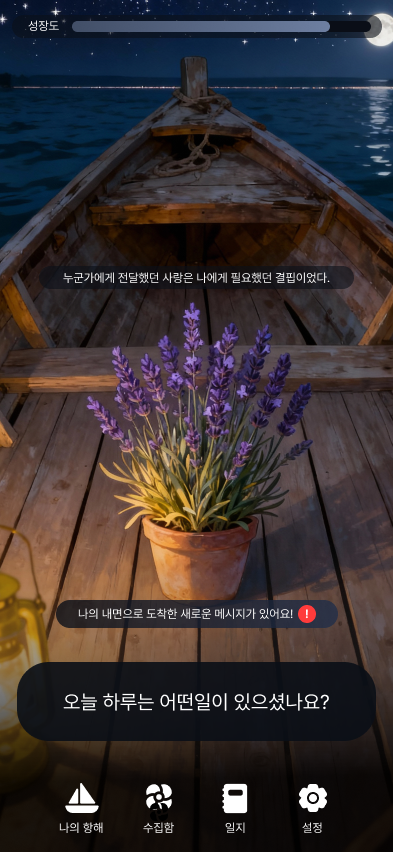 |
| "고요한 바다 위에 피어나는 나의 내면" | 메뉴: 나의 항해 · 수집함 · 일지 / 상단 성장도 게이지 |

성향 분석 결과를 식물로 보여 준다는 생각은 이때부터 있었습니다. 라벤더(평온), 연꽃(역경 극복), 해바라기(삶의 목적), 피스 릴리(회복탄력성), 수선화(새로운 시작). 이 생각이 지금의 Big5 분석과 선인장으로 이어졌습니다.

| 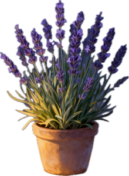 |  |  | 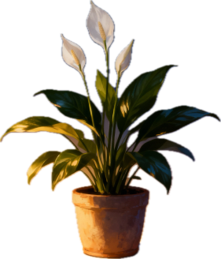 | 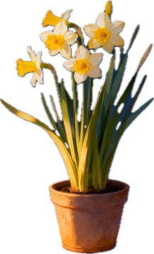 |
|:---:|:---:|:---:|:---:|:---:|
| 라벤더 | 연꽃 | 해바라기 | 피스 릴리 | 수선화 |

## 달이와 선이

하루온은 버렸습니다. 사실적인 일러스트는 AI로 생성한 이미지의 일관성을 유지하기 어려웠고, 꽃 다섯 송이의 상징 체계는 관리할 세계관이 너무 많았습니다. 그래서 여러 식물의 상징을 버려진 둘의 이야기로 모았습니다.

달이는 12간지에서 탈락해 불운의 상징이 된 검은 고양이입니다. 혼자 달을 바라봤고, 20대 청년들처럼 혼자라고 느껴 본 적이 있습니다. 달이가 밤에 일기를 가져다주는 구조는 이 설정에서 나왔습니다.

선이는 뾰족하다는 이유로 버려진 선인장입니다. 달이는 선이의 가시를 만지며 날카로움도 괜찮다는 것을 배우고, 선이는 어두운 시간을 견뎌 꽃을 피웁니다.

톤은 사실적인 일러스트에서 납작하고 따뜻한 파스텔로 바꿨습니다. 인터뷰에서도 다수가 이쪽을 원했습니다. "너무 현실적이거나 차가운 그림보다는 감정의 온도를 담은 표현이 더 와닿습니다."

### 초기 디자인

캐릭터는 먼저 손으로 그렸습니다. 달이와 선이의 일상을 그린 초기 드로잉입니다.

| 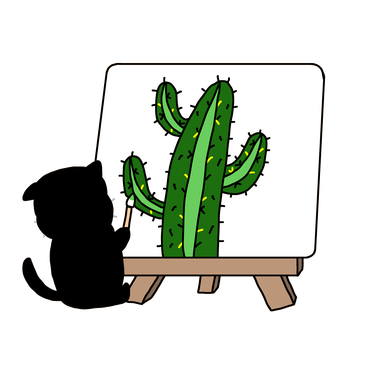 | 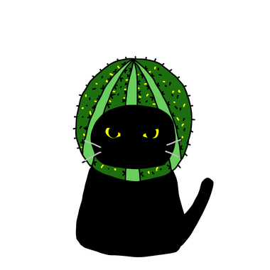 |
|:---:|:---:|
| 이젤 앞에서 선이를 그리는 달이 | 선인장 모자를 쓴 달이 |
| 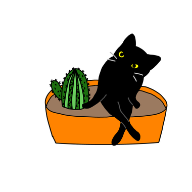 | 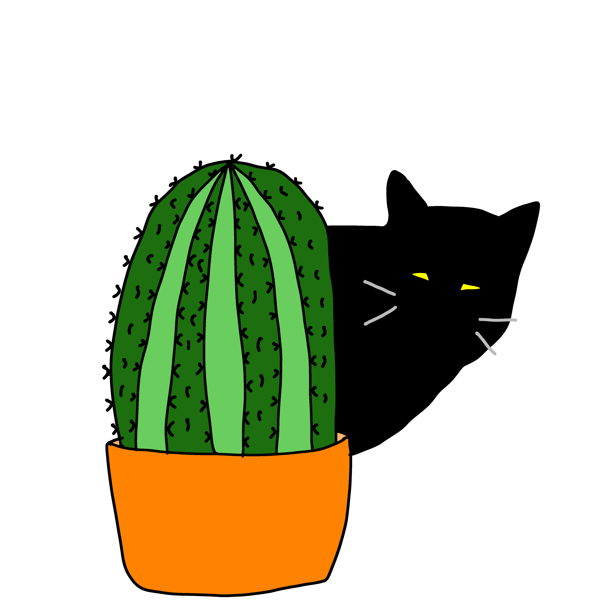 |
| 화분을 쏟고 시치미 떼는 달이 | 선이 뒤에 숨은 달이 |

### 피그마에서 다듬기

주황 고양이가 선인장을 안고 있던 첫 로고에서 시작해 픽셀풍 시안("MyCat")을 지났고, 밤을 택한 검은 고양이라는 설정이 잡히면서 검은 고양이로 다시 그렸습니다. 그 뒤로는 디자이너와 함께 눈매와 비율을 손봤습니다.

| 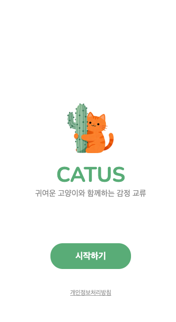 | 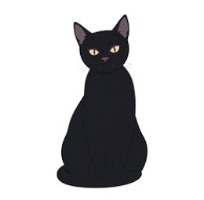 | 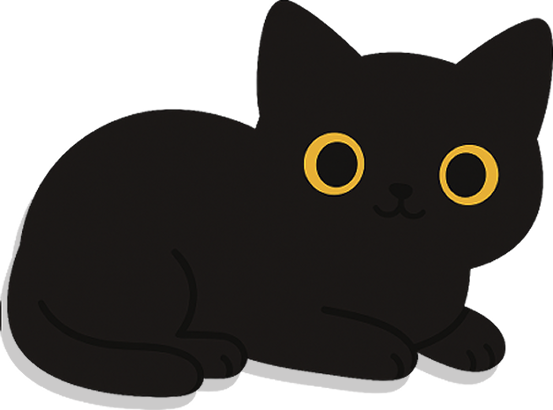 | 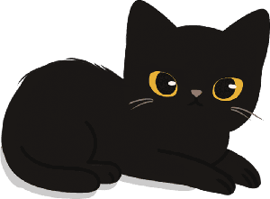 |
|:---:|:---:|:---:|:---:|
| 첫 로고 시안 | 검은 고양이 전환 | 둥근 눈 버전 | 최종 달이 (실제 앱 에셋) |

## 방 씬

배경 숲, 창틀, 선인장 둘, 공책, 종이비행기, 달이까지 직접 그려 한 장면으로 합쳤고, 낮과 밤 두 벌로 만들었습니다. 밤 씬은 달이가 일기를 가져다주는 시간대의 화면이자 다크모드 배경입니다.

| 낮 씬 | 밤 씬 | 실제 구현 (웹) |
|:---:|:---:|:---:|
| 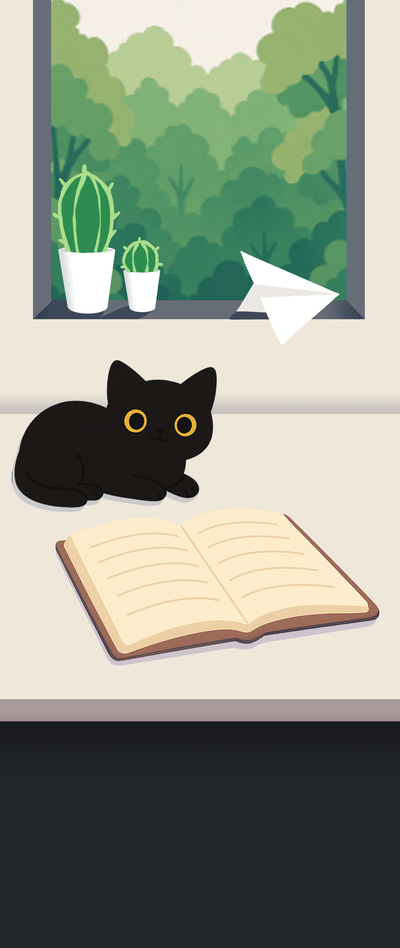 | 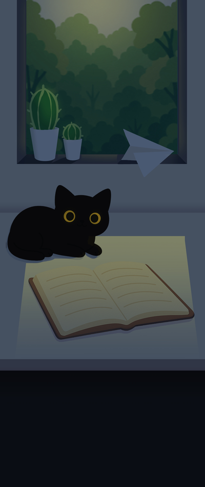 | 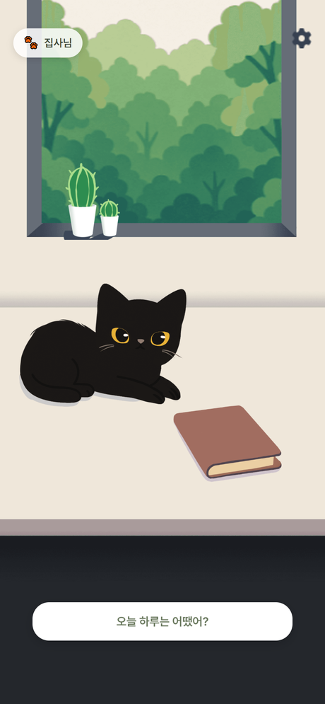 |

### 응원 메시지

응원 메시지를 어떻게 보여 줄지는 그리기 전에 문장으로 먼저 정했습니다.

> "다른 사용자의 그림일기가 날아온 걸 종이비행기로 표현"
> "다른 사용자가 나의 그림일기에 메시지를 보내줬을 때 일기장에 말풍선으로 표시"

구현하면서 둘로 나뉘었습니다. 다른 사람의 떠도는 일기는 달이를 세 번 쓰다듬으면 달이가 물어다 주고, 응원 메시지가 도착하면 종이비행기가 창가로 날아듭니다.

| 픽셀풍 시안 | 확정 시안 | 실제 구현 (웹) |
|:---:|:---:|:---:|
| 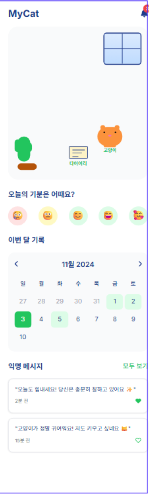 | 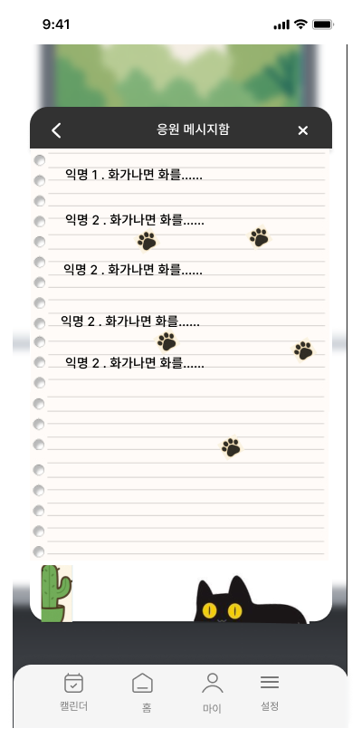 | 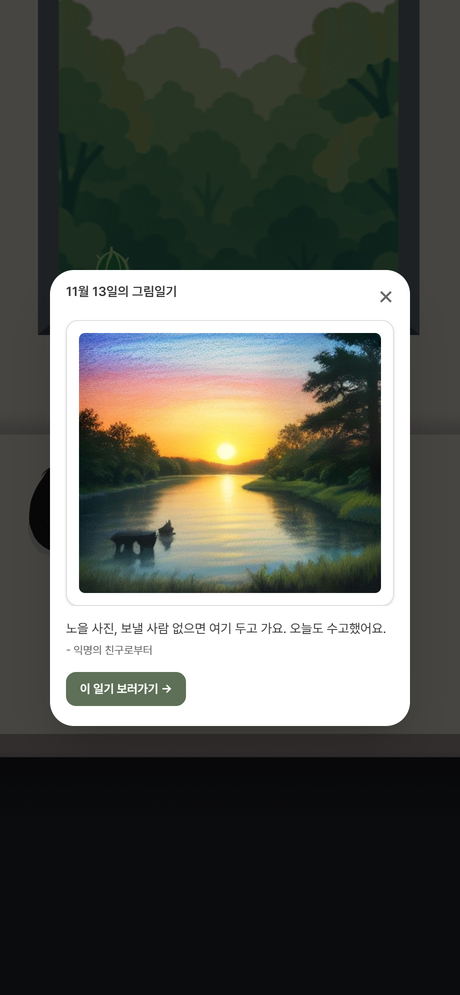 |
