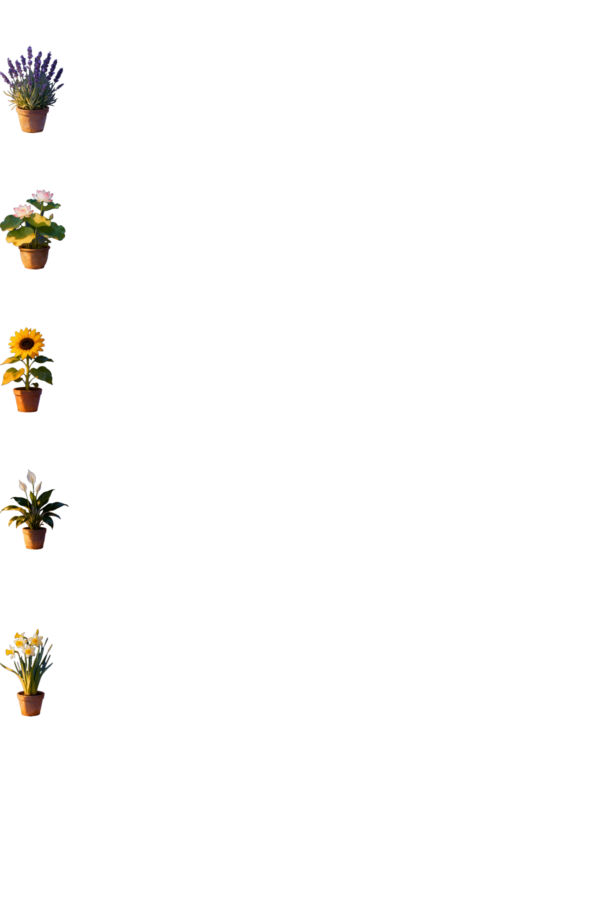
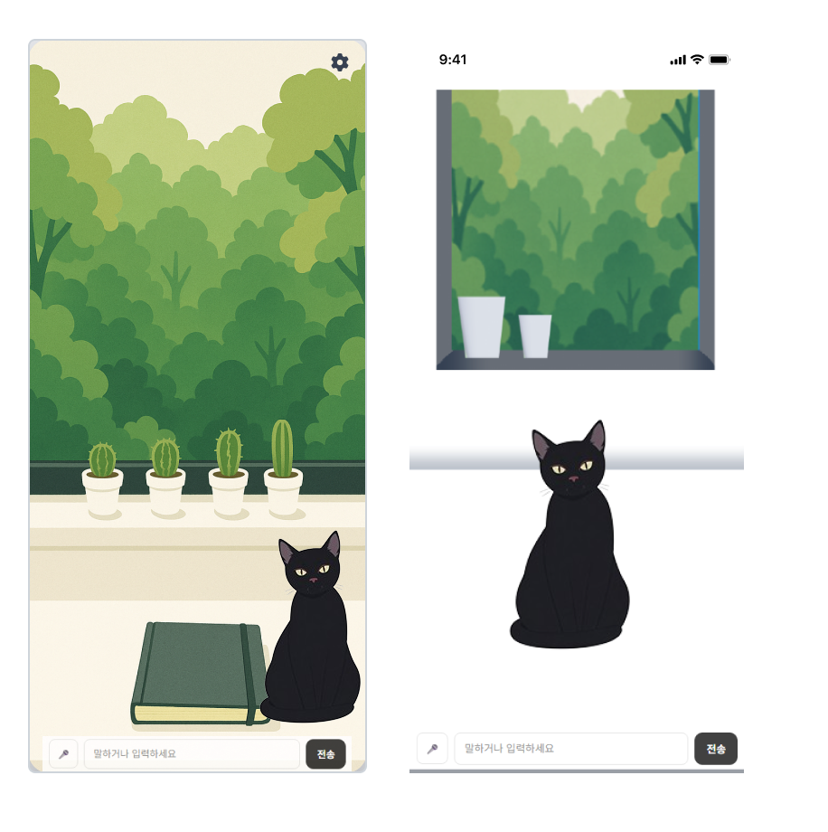

# 07. 디자인 — 하루온에서 Catus까지

외부 디자이너 없이 피그마로 직접 진행한 디자인 과정의 기록이다. 컨셉은 한 번 완전히 뒤집혔고, 그 흔적이 세 개의 피그마 파일에 남아 있다.

## 1막. 하루온 — 밤바다를 항해하는 배, 그리고 꽃

첫 번째 컨셉의 이름은 "하루온"이었다. 은유 체계는 이렇다 — **나의 내면은 배, 성장시킬 무언가는 식물(꽃·열매), 하루하루는 항해.** 사용자는 밤바다 위 자신의 배에서 꽃을 키우며 내면을 돌본다.

| 하루온 표지 | 하루온 홈 화면 |
|:---:|:---:|
|  |  |
| "고요한 바다 위에 피어나는 나의 내면" | 메뉴: 나의 항해 · 수집함 · 일지 / 상단에 성장도 게이지 |

### 꽃 × 심리 — 성향 분석 연동의 원형

하루온 단계에서 이미 "성향 분석 결과를 식물로 표현한다"는 아이디어가 있었다. 꽃마다 심리적 상징과 처방을 매핑한 문서가 남아 있다 — 라벤더(평온·치유, 자아 수용이 낮은 사용자에게), 연꽃(역경 극복), 해바라기(삶의 목적), 피스 릴리(회복탄력성), 수선화(자기애·새로운 시작).

이 "심리 상태 → 식물" 매핑이 진화한 것이 현재의 **Big5 분석 × 선인장**이다.

## 2막. 전환 — 다섯 송이의 꽃 대신, 버려진 선인장 하나

하루온 컨셉은 폐기됐다. 파일에 남은 실험 흔적(이미지 생성 모델 비교 리서치, "식물 일관성 프롬프트" 실험)이 보여주듯, 사실적 일러스트 톤은 AI 생성 이미지의 일관성 유지가 어려웠고, 다섯 가지 꽃의 상징 체계는 관리해야 할 세계관이 너무 많았다.

재편의 방향은 "여러 식물의 상징"을 **버려진 존재 둘의 이야기**로 수렴시키는 것이었다 — 12간지에서 탈락해 밤을 택한 고양이 달이, 뾰족하다는 이유로 버려진 선인장 선 (→ [01. 기획 - 네이밍과 세계관](01-planning.md)). 톤도 사실적 일러스트에서 **납작하고 따뜻한 파스텔**로 바뀌었다. 사용자 인터뷰의 소수 의견이 이 방향을 지지했다: *"너무 현실적이거나 차가운 그림보다는 감정의 온도를 담은 표현이 더 와닿습니다."*

고양이 디자인 자체도 여러 번 변했다 — 픽셀풍 간이 시안("MyCat")을 거쳐 현재의 달이에 도달했다 (아래 응원 메시지함 화면 오른쪽에 초기 시안이 남아 있다).

## 3막. Catus 디자인 확정

| 피그마 최종 시안 | 실제 구현 (웹) |
|:---:|:---:|
|  |  |
| 창가의 방, 선인장, 검은 고양이, 음성 입력 | 구현에서 책(캘린더)·설정 아이콘 배치 조정 |

응원 메시지의 UX 설정도 피그마 단계에서 정해졌다 — "다른 사용자의 그림일기가 날아온 걸 **종이비행기**로 표현", "응원 메시지는 일기장에 **말풍선**으로 표시". 메시지함은 노트 위 발자국과 빼꼼 내다보는 달이로 디자인했다:

## 설계 체계의 흔적

와이어프레임 외에도 서비스 전체를 설계한 산출물이 함께 남아 있다 — 회원가입 퍼널 정의, 온보딩 시나리오(감정분석 온보딩 1~8), 그리고 가입부터 배치 일기 생성·공개 범위·구독 모델(월 4,900~9,900원 가설)까지 그린 사용자 흐름도:

흐름도의 뼈대(가입 → 성향 분석 → 자유 대화 → 지정 시간 배치 생성 → 공개 선택 → 익명 응원)는 실제 구현과 거의 일치한다. 구독·채팅 횟수 제한 같은 수익화 요소는 구현에서 제외하고 로드맵으로 남겼다.

## 구현으로 이어진 것 / 달라진 것

| 피그마 설계 | 구현 |
|---|---|
| 창가의 방 + 선인장 + 달이 + 책 | 그대로 (에셋 직접 제작) |
| 음성 입력 버튼 | 그대로 (Web Speech API) |
| 종이비행기로 날아오는 타인의 일기 | 그대로 |
| 성향 분석 온보딩(가이드 대화 5~10분) | 10문항 테스트 + 주간 대화 기반 EMA로 간소화 |
| 채팅 횟수 제한·구독 유도 | 제외 (무료, 로드맵) |
| 일기 생성 기점 "설정 시간 2~3시간 전 배치" | 사용자 지정 시간 정각 배치 + 미리 받기·재생성 |
