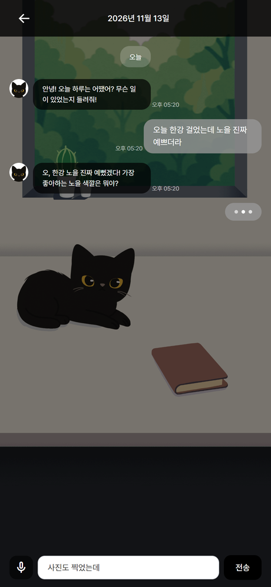
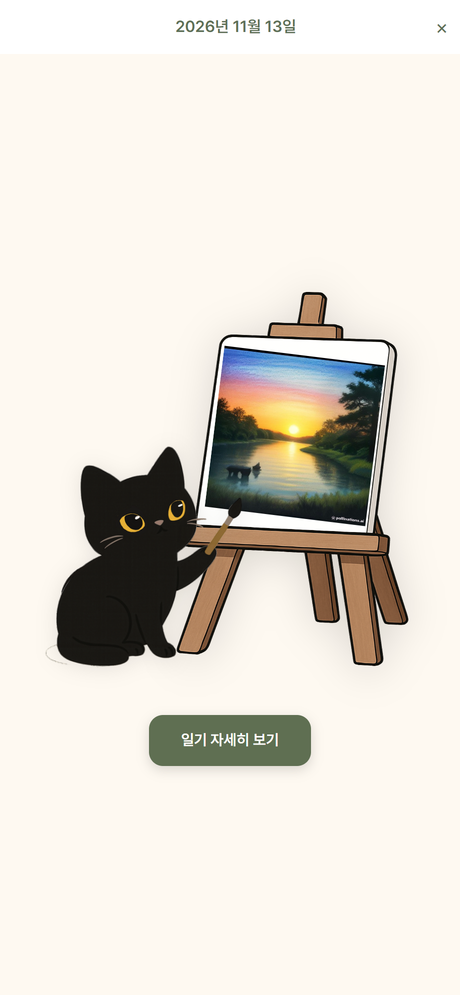
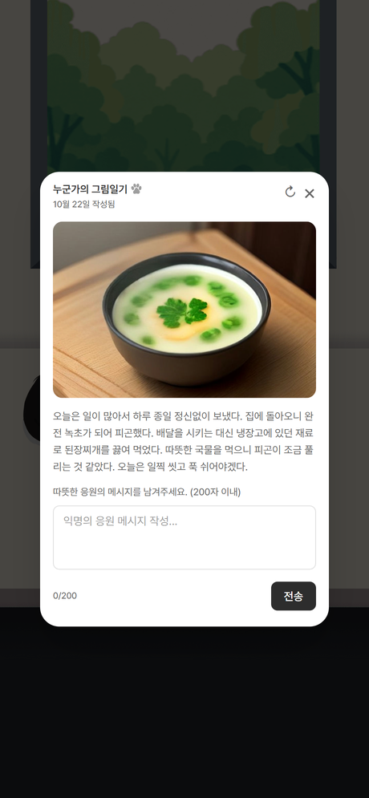

# Catus

하루 끝에 고양이 달이에게 오늘 있었던 일을 이야기하면, 그날 밤 그림일기가 도착합니다. 일요일에는 한 주를 돌아보는 편지가 오고, 공개한 일기에는 익명의 사용자가 응원을 남깁니다.

힘든 이야기를 꺼낼 곳이 없는 20대를 위해 만들었습니다. 고립되기 전부터 매일 가볍게 쓰는 기록으로 일상에 자리 잡는 것이 목표입니다.

<figure markdown>
{ width="230" }
<figcaption>오늘 있었던 일을 달이에게 말하면</figcaption>
</figure>

<figure markdown>
{ width="230" }
<figcaption>그날 밤 달이가 그림일기를 그려 옵니다</figcaption>
</figure>

<figure markdown>
{ width="230" }
<figcaption>누군가의 일기가 날아오면 익명으로 응원을 보냅니다</figcaption>
</figure>

[데모 체험하기](https://catus-app.vercel.app){ .md-button .md-button--primary }
[기획부터 읽기](01-planning.md){ .md-button }

가입 없이 게스트로 체험할 수 있으며 모바일 화면에 맞춰 만들었습니다. 무료 서버라 첫 접속이 느릴 수 있습니다.

## 소개

**대화가 곧 일기입니다.**  
일기 쓰기는 어려워도 오늘 있었던 일을 말로 하는 것은 어렵지 않습니다. 그래서 달이와 나눈 대화가 그대로 일기가 되도록 했습니다. [기획](01-planning.md)

**없던 하루를 지어내지 않습니다.**  
일기에는 대화에 실제로 나온 사건과 감정만 씁니다. 대화가 없는 날은 일기도 만들지 않습니다. [설계](03-architecture.md)

**위로는 AI가 아니라 사람이 보냅니다.**  
인터뷰에서는 "AI 위로는 정신승리"라는 회의적인 반응과 함께 "AI를 통해 사람들과 소통하는 방식이라면 좋겠다"는 요구가 있었습니다. 털어놓고 싶지만 아는 사람에게 약한 모습을 보이기는 싫다는 답도 많았습니다. 그래서 공개에 동의한 일기에 다른 사용자가 익명으로 응원을 보내는 방식을 택했습니다. [기획과 리서치](01-planning.md#털어놓고-싶지만-보이기는-싫다)

---

## 만든 사람

기획, 사용자 인터뷰, 백엔드와 LLM 프롬프트, 배포와 운영을 혼자 했고, 캐릭터는 직접 그린 뒤 디자이너와 함께 다듬었습니다. Java 21, Spring Boot 3.2, PostgreSQL, Gemini API, React 19로 만들었고, 아직 무료 인프라에서 돌고 있습니다.

문제를 어떻게 정의했고 무엇을 만들었는지는 네 페이지에 나눠 적었습니다.

- [**기획과 리서치**](01-planning.md) 20대 인터뷰에서 시작해 상담사와 창업가를 만나며 고립 전 청년으로 대상을 다시 정한 과정
- [**디자인**](07-design.md) 첫 컨셉을 뒤집고, 손으로 그린 캐릭터가 앱 화면이 되기까지
- [**설계**](03-architecture.md) 백엔드 구조와 LLM 프롬프트, 하루의 흐름과 데이터 모델
- [**운영과 회고**](04-troubleshooting.md) 배포 뒤 겪은 문제와 회고

코드 저장소는 정식 출시 전이라 비공개입니다. 열람이 필요하면 [freaks17489@gmail.com](mailto:freaks17489@gmail.com)으로 연락 주세요.
