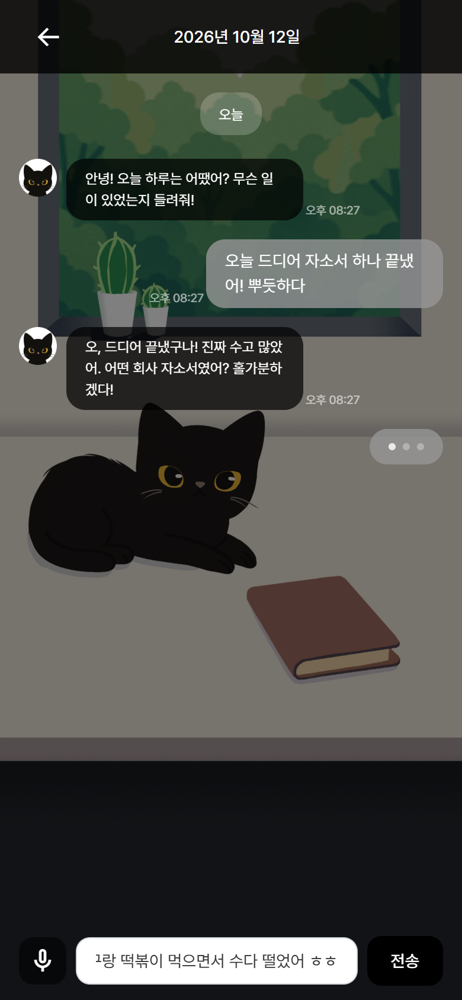
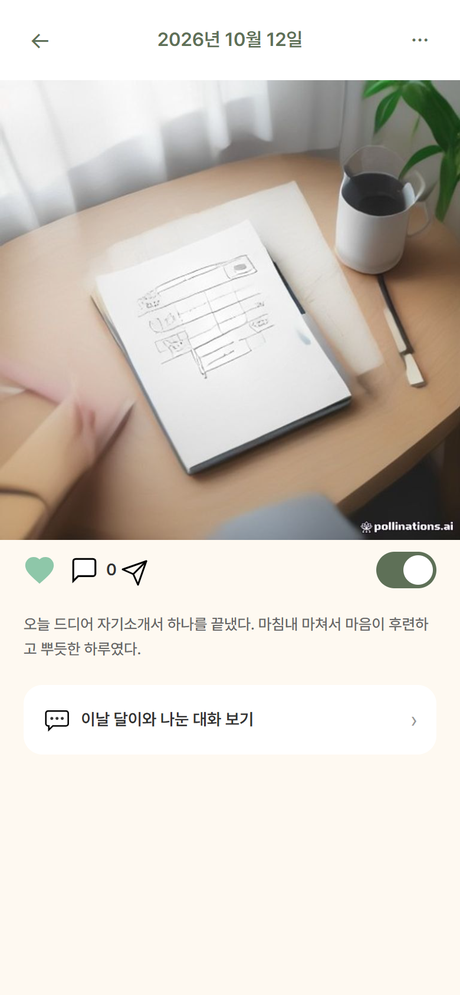
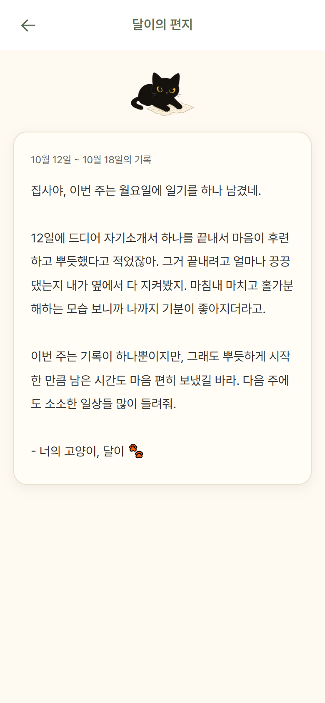

# 혼자 쓰기 어려운 일기를, 함께

Catus는 고양이 "달이"와 가볍게 수다를 떨면 하루가 그림일기가 되는, 고립 전 청년을 위한 감정 기록 서비스다.
이 사이트는 Catus를 혼자 기획하고, 조사하고, 그리고, 만들고, 운영한 과정의 기록이다.

[달이 만나러 가기 (데모)](https://catus-app.vercel.app){ .md-button .md-button--primary }
[과정 읽기: 기획부터](01-planning.md){ .md-button }

|  |  |  |
|:---:|:---:|:---:|
| 달이와의 수다가 | 그날의 그림일기가 되고 | 매주 편지가 도착한다 |

---

## 이 기록에서 읽을 수 있는 것

| | 한 줄 요약 | 문서 |
|---|---|---|
| 왜 만들었나 | 이미 고립된 청년은 서비스를 찾지 않는다. 그래서 고립 전의 일상으로 갔다 | [기획](01-planning.md) |
| 무엇을 들었나 | "약한 모습을 보이기 싫다"는 답이 커뮤니티를 지우고 익명 응원을 만들었다 | [리서치](06-user-research.md) |
| 어떻게 그렸나 | 첫 컨셉 하루온을 버리고 달이와 선으로 재편했다. 달이는 네 번 다시 그렸다 | [디자인](07-design.md) |
| 어떻게 만들었나 | 모놀리스, 프롬프트 모듈화, 무료 인프라 제약을 설계로 흡수 | [ERD](02-erd.md) · [설계](03-architecture.md) |
| 무엇을 배웠나 | 실서비스에서 겪은 문제 6가지 (응답 6.8초에서 1.5초로 등) | [트러블슈팅](04-troubleshooting.md) · [회고](05-retrospective.md) |

---

기획, 디자인, 개발, 배포, 운영 1인 수행 · Spring Boot 3 · PostgreSQL · Gemini · React 19
코드 저장소는 정식 출시 준비 중이라 비공개다. 열람이 필요하면 [freaks17489@gmail.com](mailto:freaks17489@gmail.com)으로 연락 바란다.
